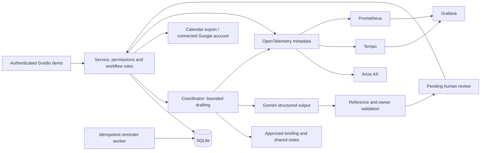

# CirclePath

An AI coordinator for restorative justice volunteers: case review, team formation, preparation,
conferences, repair support, reintegration, and reviewed learning. People lead the restorative process;
the software coordinates tasks and prepares drafts.

**This repository is a local demonstration using entirely fictional cases.** It is not a certified
juvenile case management system. Its privacy controls and workflow gates are implemented and tested,
but real deployment requires the program's own policies, legal review, and security engineering.

## What works

- Password-authenticated manager and volunteer accounts; authorization enforced in the service layer.
- Role signup with training and confidentiality checks, conflict disclosures, and manager approval.
- Approved briefing access; office-only reports stay out of volunteer screens and AI context.
- Ongoing consent, readiness decisions, pausing, alternative closure, and a gated case lifecycle.
- Persistent SQLite cases, tasks, debriefs, repair commitments, meetings, notifications, and audit records.
- Live Gemini structured drafting with source references, authorized owners, and human review.
- Preparation questions and language guidance from an editable program playbook.
- A bounded reminder worker: meeting check-ins, task reminders, repair barriers, and staffing gaps.
- Team availability intersection, rescheduling, stable calendar IDs, personal `.ics` downloads.
- Optional Google Calendar OAuth connection and event synchronization to each connected account.
- Private volunteer debriefs excluded from AI; manager-reviewed learning library.
- Human-approved summary export, and no automatic external case report submission.
- OpenTelemetry spans, token counters, latency histograms, workflow metrics, and safe local traces.
- Arize AX OTLP export plus a second destination for Grafana Tempo.
- A provisioned Grafana dashboard and Prometheus metrics, with native and Docker deployment options.
- Explicit offline mode for demonstrations and deterministic integration checks.

## Run locally

Use Python 3.12 (Python 3.11+ supported).

```bash
python3.12 -m venv .venv
.venv/bin/python -m pip install -r requirements.lock
.venv/bin/python -m pip install --no-deps --no-build-isolation -e .
cp .env.example .env
```

Edit `.env` with file paths to existing keys, not their contents:

```dotenv
GEMINI_API_KEY_FILE=/absolute/path/gemini.key
ARIZE_API_KEY_FILE=/absolute/path/arize.key
ARIZE_SPACE_ID=your-space-id
```

The Gemini model is configurable; the default is the live-tested `gemini-3.1-flash-lite`. Arize requires both an API key
and a Space ID. If no Space ID is configured, local tracing works and Arize export remains explicitly
disabled. Environment variables containing keys are also supported. Credentials are never sent to
Grafana or stored in source.

```bash
.venv/bin/python -m circlepath seed
.venv/bin/python -m circlepath serve
```

Open **http://127.0.0.1:7860**. Use the generated usernames and passwords in `data/demo-login.txt`.
`manager` sees program controls; `avery`, `jordan`, `casey`, `quinn`, `sam`, and `riley` exercise the
volunteer roles. Passwords are generated per installation; they are not public demo credentials.
Rerunning seed preserves existing data.

Without an AI key:

```bash
.venv/bin/python -m circlepath serve --provider offline
```

Offline drafts are visibly labeled and recorded as `offline / deterministic-demo`. They never
masquerade as a live model response.

## Demonstration walkthrough

1. Sign in as `manager`. Open **Demo · Cedar** and inspect its briefing, team, consent, and next steps.
2. Review Riley's pending request for the optional third community member role.
3. Open **Prepare with AI**, choose a preparation plan, and generate a draft.
4. Read the attributed facts and source references. Edit the summary and proposed coordination tasks.
5. Record human approval. Only then are the proposed tasks created.
6. Use **Meetings & calendar** to find shared availability and schedule the next meeting after confirmation.
7. Download a personal calendar as a volunteer, or sync an explicitly connected Google account.
8. Record meeting completion. Each assigned member receives a debrief check-in in their inbox.
9. Move through pre-conference and conference with current consent and the facilitator's readiness decision.
10. Record only participant-agreed repair commitments; the support owner submits progress and another
    facilitator or manager verifies the evidence.
11. Schedule and complete the chosen reintegration process, close the case, and review a final summary.
12. Review de-identified lessons before publishing them to the program library.

**Demo · Willow** starts in repair with a transport barrier. **Demo · Aspen** starts with an unfilled
team and pending participant choices. A declined or withdrawn required consent pauses a case and
cancels scheduled meetings. Restoring consent does not automatically resume or declare readiness.

Use **Refresh case** after mutations to reload tables and available actions.

## Grafana and OpenTelemetry

The native launcher downloads checksum-verified official binaries into ignored local storage. It
does not install a system service or require Docker. macOS and Linux, ARM64 and AMD64 are supported.

```bash
.venv/bin/python scripts/local_observability.py install
.venv/bin/python scripts/local_observability.py start
```

Add this to `.env` before starting the app:

```dotenv
OTEL_EXPORTER_OTLP_TRACES_ENDPOINT=http://127.0.0.1:4320/v1/traces
```

Open **http://127.0.0.1:3300/d/circlepath/circlepath**. Prometheus runs on port 9091, Tempo on 3201,
and Tempo accepts OpenTelemetry traces on 4320. All native service listeners bind to loopback.
The dashboard is available to a local anonymous Viewer; a generated Grafana admin password is in
`data/observability/grafana-login.txt`. The demo exports only operational metadata.

```bash
.venv/bin/python scripts/local_observability.py stop
```

Alternatively, set `GRAFANA_ADMIN_PASSWORD` in your local `.env`, then `docker compose up --build`
launches the app, OpenTelemetry Collector, Grafana,
Prometheus, and Tempo. Arize export remains in the app process, avoiding copying its credentials
into a collector configuration. The Docker Collector forwards a second copy of traces to Tempo.

### Signals and evaluations

- Spans: retrieval → model → reference/owner validation → draft persistence → human review.
- Metrics: AI requests and errors, input/output tokens, latency, review decisions, reminders,
  workflow operations, cases by stage, and overdue tasks.
- Arize project: `ARIZE_PROJECT_NAME`, default `circlepath-rj`.
- A successful exporter batch and a configured exporter are reported separately in the manager UI.
- Reference integrity means source IDs exist; it is **not** a factual entailment or fairness score.
- Operational telemetry never contains prompts, case narratives, participant names, usernames,
  private debriefs, calendar locations, passwords, or credentials. Full prompt capture and provider
  auto-instrumentation are deliberately absent. SDK exception messages are not put in spans.
- Local `data/traces.jsonl` contains the same safe metadata; it is not committed.

## Calendar and reminders

Calendar downloads work immediately. Importing an `.ics` file does not create an automatically
updating subscription; re-download after changes, or connect Google Calendar for synchronization.
Stable event IDs and sequence numbers preserve reschedules and cancellations. Released volunteers
receive cancelled entries for their former calendar membership.

To enable Google Calendar, create a desktop OAuth client with Google, set `GOOGLE_OAUTH_CLIENT_FILE`,
then run the connection command locally **as the account holder**:

```bash
.venv/bin/python -m circlepath calendar-connect --username sam
```

The browser consent flow grants access to owned calendar events. Tokens stay in `data/calendar/`.
Use **Sync connected Google Calendar** when signed in as that volunteer. No account is connected
automatically. This integration needs your own OAuth setup; it cannot be verified without a connection.

In-app reminders run every minute. Email delivery is disabled. Optional SMTP sends only a generic
notice to registered volunteer addresses, after explicit configuration in `.env`; no youth contact
details are collected. Fictional `.example` accounts are never emailed. Microsoft Calendar integration
is not included; Microsoft and Apple calendars can import the personal `.ics` file.

## Architecture



The model cannot call files, calendars, messaging tools, or stage-changing functions. Its only
output is a validated draft. Human-approved coordination tasks can be persisted; repair obligations
need separate explicit participant agreement. The scheduler never executes model-generated decisions.

## Tests and quality checks

```bash
.venv/bin/python -m pytest -q
.venv/bin/ruff check circlepath tests scripts
.venv/bin/python scripts/check_publication.py
```

Tests exercise the full lifecycle, authorization, capacity, consent withdrawal, private-note
isolation, stale and duplicate approvals, invalid sources and owners, repair verification,
calendar changes, reminder idempotency, summary export, and telemetry privacy. The publication
check checks tracked files and optionally exact local secret values without printing them.
CI runs without live AI keys or external integrations.

## Before a real program deployment

The manager needs to approve the playbook, report digitization, AI processing, confidentiality and
reporting exceptions, role qualifications, consent practices, record retention, and permitted reports.
The demonstration consent records are staff attestations, not participant signatures.

Replace local password accounts with institutional SSO and MFA; add encrypted managed storage,
backups, retention/deletion controls, tenant isolation, and protected file downloads bound to each
recipient. Demo export links are opaque, authenticated Gradio file links, not a production document
sharing system. Review the AI provider's data terms before sending any real briefing. Audit the
program's policy against the actual deployment; the repository makes no HIPAA, CJIS, or other
compliance claim. No automated assessment of honesty, remorse, risk, readiness, or case outcomes
belongs in this product.

## Technical references

- [Gradio Blocks](https://www.gradio.app/docs/gradio/blocks)
- [Gemini structured output](https://ai.google.dev/gemini-api/docs/structured-output)
- [Arize tracer configuration](https://arize.com/docs/ax/instrument/configure-your-tracer)
- [OpenTelemetry Python instrumentation](https://opentelemetry.io/docs/languages/python/instrumentation/)
- [Grafana Tempo setup](https://grafana.com/docs/tempo/latest/docker-example/)
- [Colorado restorative justice practitioner guidelines](https://rjcolorado.org/restorative-justice-defined/standards/)

License: MIT.
